# Mettre à jour Nina de la version 1.0 à la version 1.1

Ce guide explique comment installer la **version 1.1** de Nina sur une tablette qui a déjà la **version 1.0**, à partir du fichier d'installation reçu (`Nina-1.1.apk`), **en gardant toutes les grilles déjà préparées**.

Durée : environ 10 minutes. Aucun ordinateur n'est nécessaire : tout se fait sur la tablette.

Sur les images, **les ronds orange numérotés montrent où toucher**, dans l'ordre des étapes. Les écrans peuvent être un peu différents sur votre tablette (couleurs, noms des boutons), mais les étapes restent les mêmes.

---

## En bref

> **La mise à jour s'installe par-dessus la version 1.0 : vos grilles, dossiers, photos et statistiques restent en place.**
>
> **La seule chose à ne jamais faire : désinstaller Nina.** Désinstaller efface tout ce que vous avez préparé.

---

## 1. Ce qui est conservé, ce qui change

### Conservé
- La grille de l'accueil et tous les pictos ajoutés ou modifiés.
- Les dossiers et leur contenu.
- Les photos ajoutées depuis la galerie.
- Les statistiques d'utilisation.
- Les réglages (couleur de fond, voix…).

### Ce qui change en 1.1
- **Le cadenas** (en haut à droite) est maintenant petit et gris : il faut **le maintenir appuyé 2 secondes** pour ouvrir le mode adulte, puis résoudre le calcul.
- **Le mode adulte** affiche une **barre d'outils en haut de l'écran** : Ajouter, Édition, Paramètres, Statistiques, Aide, taille de la grille, et un menu **⋮** pour le reste (sauvegarde, restauration, grilles prêtes…).
- **La colonne de gauche** contient maintenant les **dossiers** (Actions, Nourriture, Personnes…), avec **Accueil** toujours en haut. Si vous n'aviez pas modifié la colonne de gauche en 1.0, elle est remplacée par ces nouveaux dossiers. Vos propres dossiers restent dans la grille, à leur place.
- **La taille de la grille** (nombre de pictos par rangée) n'était pas mémorisée en 1.0 : vérifiez-la après la mise à jour avec les boutons **− / +** de la barre du mode adulte.
- **La grille ne défile plus** : s'il y a trop de pictos, des boutons **◀ Page ▶** apparaissent en bas.
- Nouveautés : photos prises directement avec la tablette, planche imprimable, formes des verbes par appui long, aide entièrement refaite (**Aide**, dans la barre du mode adulte).

---

## 2. Avant de commencer

- [ ] La tablette est **chargée à plus de 30 %** (ou branchée).
- [ ] Vous avez reçu le fichier **`Nina-1.1.apk`** (par mail, WhatsApp, Drive, clé USB…).
- [ ] Il reste au moins **200 Mo d'espace libre** sur la tablette.
- [ ] Vous avez un peu de temps devant vous, Nina n'a pas besoin de la tablette.

---

## 3. Étape 1 : faire une sauvegarde de sécurité (5 minutes)

Normalement, la mise à jour ne touche à rien. Cette sauvegarde sert seulement de filet de sécurité si quelque chose tournait mal. Tout se passe dans **Nina 1.0**.

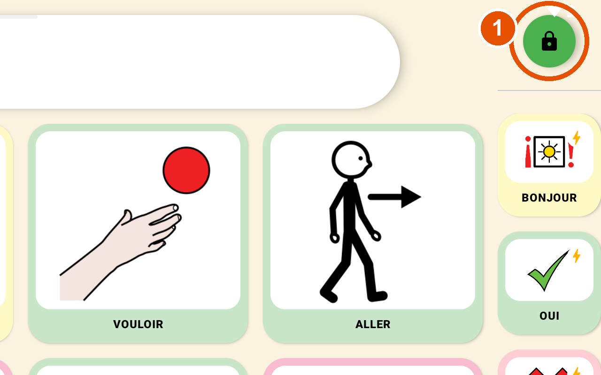

1. Touchez le **cadenas vert** en haut à droite.

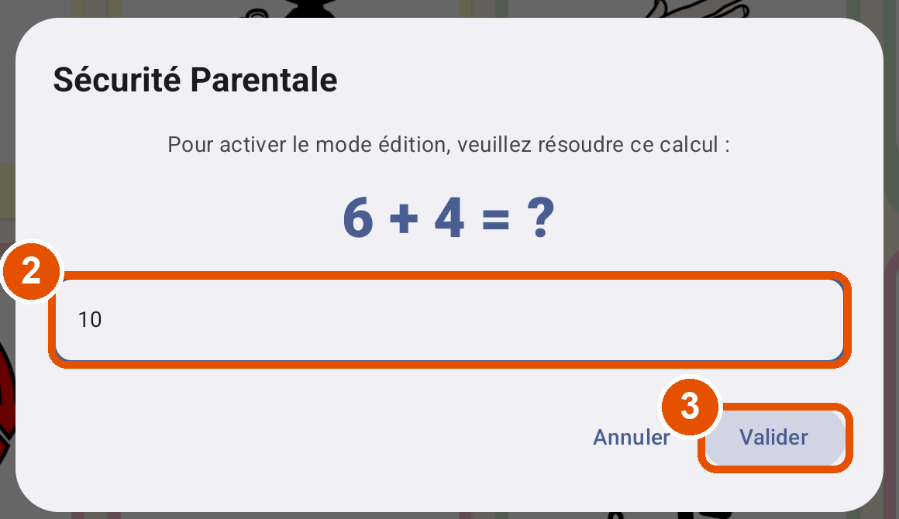

2. Tapez le résultat du petit calcul.
3. Touchez **Valider**. Le cadenas devient jaune.

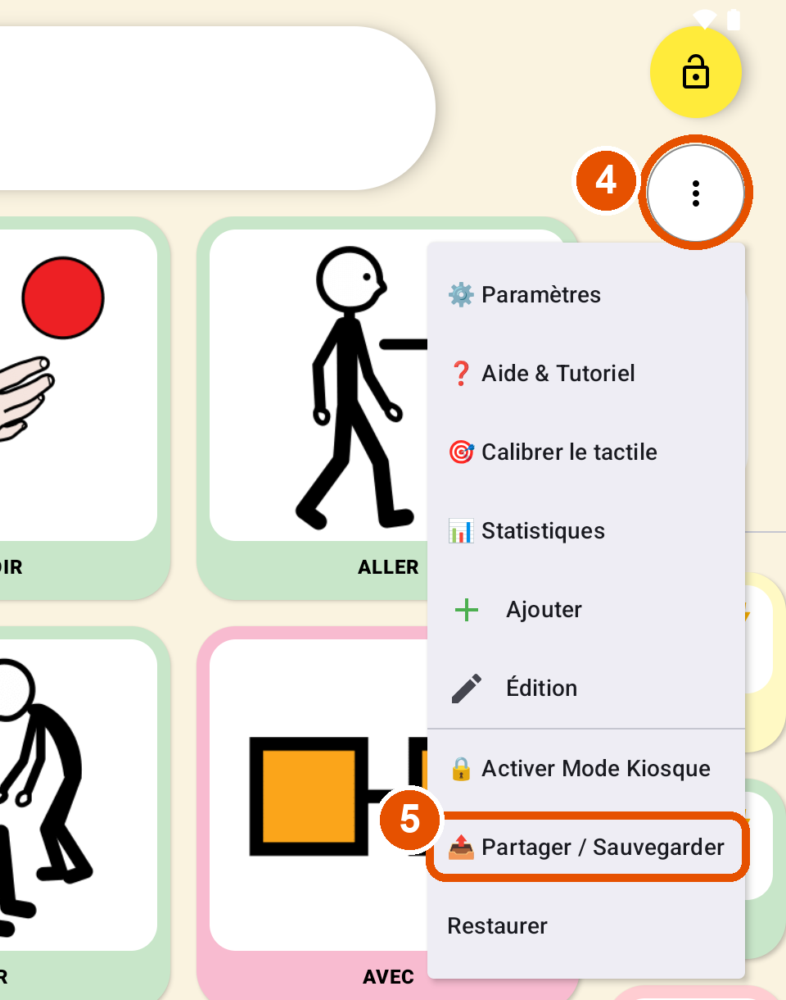

4. Touchez le bouton **⋮** (trois points), juste sous le cadenas.
5. Choisissez **Partager / Sauvegarder**.

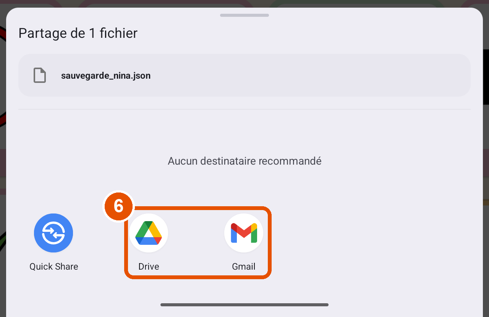

6. Choisissez où envoyer le fichier **`sauvegarde_nina.json`** : **Gmail** pour vous l'envoyer par mail, ou **Drive** pour le ranger dans Google Drive.
7. Revenez dans Nina et touchez le **cadenas jaune** pour le refermer.

> Ce fichier contient vos grilles et vos dossiers. Les **photos de la galerie** n'y sont pas incluses en version 1.0 : elles restent sur la tablette et seront conservées par la mise à jour, mais pas par ce fichier de secours.

---

## 4. Étape 2 : récupérer le fichier `Nina-1.1.apk` sur la tablette

Ouvrez le message (mail, WhatsApp…) qui contient **`Nina-1.1.apk`** et **téléchargez** la pièce jointe. Le fichier arrive en général dans le dossier **Téléchargements** (application **Mes fichiers** ou **Fichiers**).

> Si le fichier est sur une clé USB ou un ordinateur, copiez-le dans le dossier **Téléchargements** de la tablette.

---

## 5. Étape 3 : installer la mise à jour

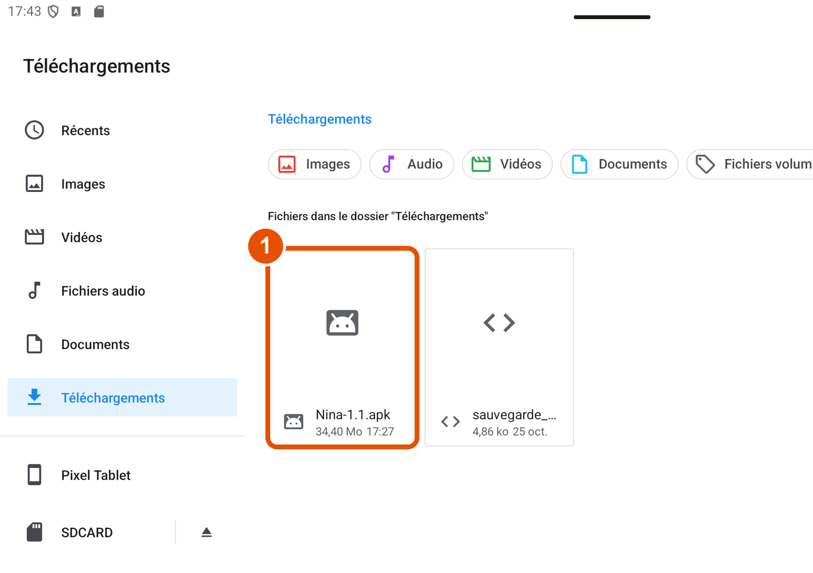

1. Ouvrez l'application **Mes fichiers** (Samsung) ou **Fichiers** (autres tablettes), puis le dossier **Téléchargements**, et touchez **`Nina-1.1.apk`**.

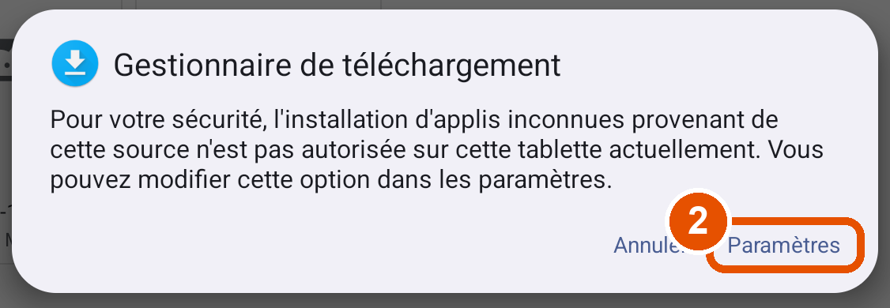

2. **La première fois**, Android bloque l'installation par sécurité. C'est normal : touchez **Paramètres**.

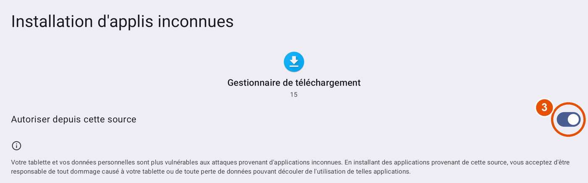

3. Activez **Autoriser depuis cette source** (ou *Autoriser à partir de cette source*), puis revenez en arrière avec la flèche **←** en haut à gauche. Retouchez **`Nina-1.1.apk`** si l'installation ne reprend pas toute seule.

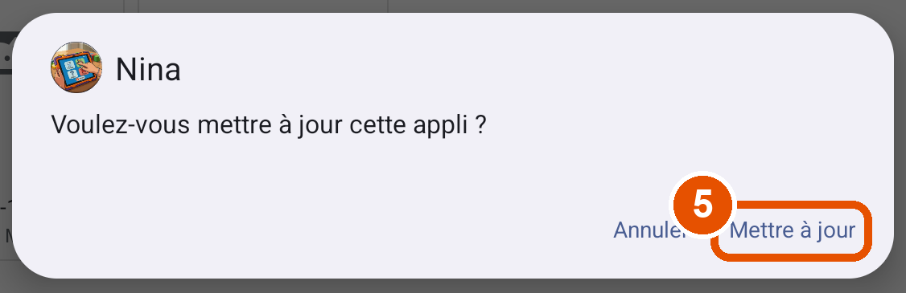

4. Android demande **« Voulez-vous mettre à jour cette appli ? »**.
5. **C'est le bon signe** : il s'agit d'une mise à jour, vos données sont conservées. Touchez **Mettre à jour**.

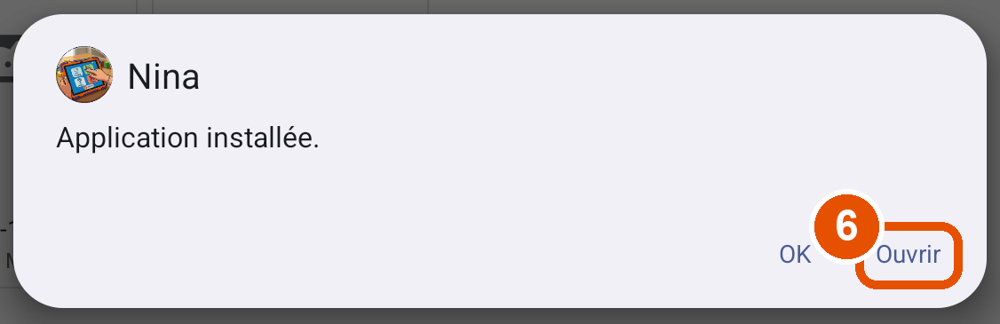

6. Attendez le message **« Application installée »**, puis touchez **Ouvrir**.

> Si **Google Play Protect** affiche *« Application non sécurisée bloquée »* ou *« Appli inconnue »* : touchez **Plus de détails**, puis **Installer quand même**. Ce message apparaît pour toute application qui ne vient pas du Play Store. Si on vous propose d'**envoyer l'appli pour analyse**, vous pouvez refuser.

> Attention : **si Android propose « Installer » au lieu de « Mettre à jour »**, ou affiche une erreur comme *« Application non installée »* ou *« L'application est en conflit avec un package existant »* : **arrêtez-vous et ne désinstallez rien.** Vos données sont intactes. Voir la section 8.

---

## 6. Étape 4 : vérifier que tout est là

Ouvrez Nina :

- [ ] Vos pictos et vos dossiers sont dans la grille. S'il y a plusieurs pages, utilisez **▶** en bas pour voir la suite.
- [ ] Vos **photos** s'affichent sur leurs pictos.
- [ ] Toucher un picto le fait bien dire à voix haute.

Puis ouvrez le **mode adulte** pour vérifier la version :

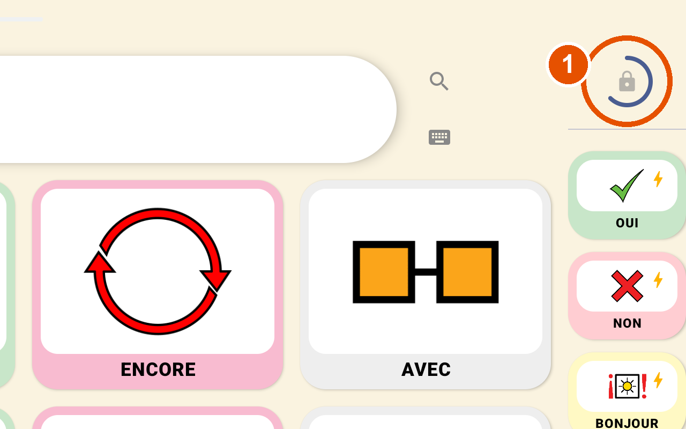

1. **Maintenez le doigt 2 secondes** sur le **petit cadenas gris** en haut à droite : un anneau bleu se remplit. Puis résolvez le calcul et touchez **Valider**, comme à l'étape 1.

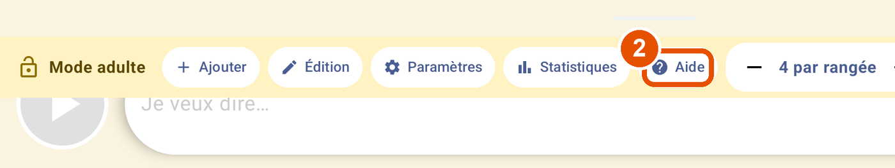

2. Dans la barre jaune en haut de l'écran, touchez **Aide**.

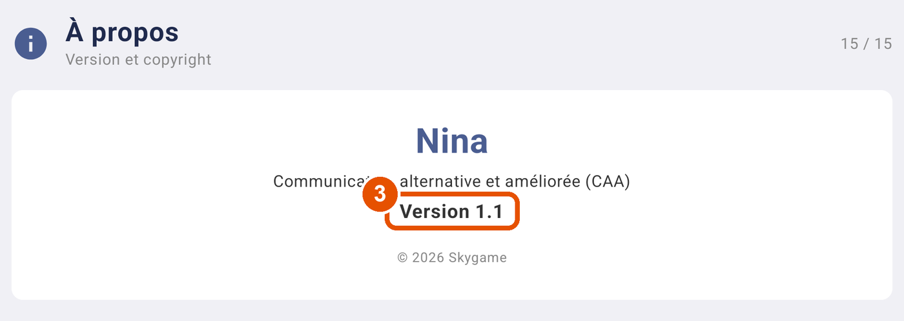

3. Faites défiler la liste de gauche jusqu'en bas et touchez **À propos** : la page doit afficher **Version 1.1**.

---

## 7. Étape 5 : prendre en main la version 1.1

En mode adulte (cadenas maintenu 2 secondes) :

- **Taille de la grille** : utilisez **− / +** dans la barre jaune pour choisir le nombre de pictos par rangée.
- **Ranger les dossiers** : la colonne de gauche est faite pour les dossiers. Pour y placer un de vos dossiers, faites un **appui long** dessus dans la grille, puis faites-le **glisser** dans la colonne de gauche.
- **Ajouter un picto** : **Ajouter**, puis choisissez la zone (grille, colonne de gauche ou phrases rapides). Les boutons **Prendre une photo** et **Galerie** permettent d'utiliser une vraie photo.
- **Tout découvrir** : **Aide** présente chaque fonction pas à pas.
- **Refermer le mode adulte** : bouton **Verrouiller**, en haut à droite.

**Pensez à refaire une sauvegarde en version 1.1** : **⋮ › Partager / Sauvegarder**. Ce nouveau fichier contient aussi **les photos** : il permet de tout retrouver, même sur une autre tablette.

---

## 8. En cas de problème

### « Application non installée » ou « en conflit avec un package existant »
Le fichier 1.1 n'a pas été fabriqué avec la même « signature » que votre version 1.0. **Rien n'a été modifié, vos grilles sont toujours là.**

→ **Le plus simple** : prévenez la personne qui vous a envoyé l'application. Elle pourra vous envoyer une version compatible.

→ **Seulement si vous ne pouvez pas attendre**, et seulement si la sauvegarde de l'étape 1 est bien en lieu sûr :

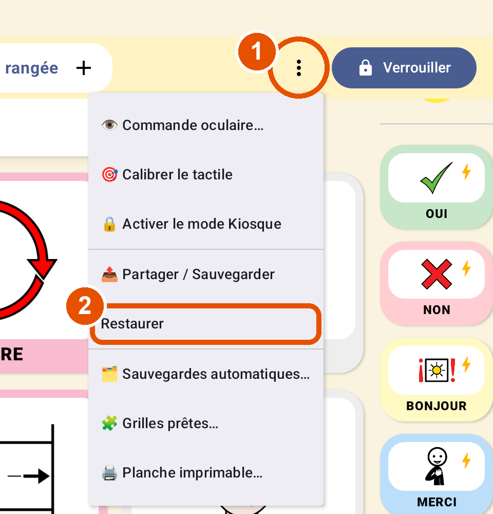

1. Désinstallez Nina : appui long sur l'icône › **Désinstaller**. Attention : cela efface tout sur la tablette.
2. Installez `Nina-1.1.apk` (étape 3).
3. Ouvrez Nina, maintenez le cadenas 2 secondes, résolvez le calcul.
4. Touchez **⋮** (barre jaune, à droite) › **Restaurer**, puis choisissez le fichier `sauvegarde_nina.json` de l'étape 1 (dans **Téléchargements**, ou téléchargez-le d'abord depuis votre mail ou Drive).
5. Votre grille et vos dossiers reviennent. Les **photos de la galerie**, elles, sont à remettre une par une : mode **Édition**, toucher le picto, puis **Galerie**.

### L'installation est bloquée sans proposer de réglage
Ouvrez les **Paramètres** de la tablette › **Applications** › menu **⋮** › **Accès spécial** › **Installer des applis inconnues**, puis autorisez **Mes fichiers** (ou l'application qui contient le fichier : Gmail, Chrome, WhatsApp…).

### La grille a disparu au démarrage
Si Nina affiche **« Grille récupérée »**, elle a repris automatiquement sa dernière sauvegarde du jour. Sinon, utilisez **⋮ › Restaurer** avec le fichier de l'étape 1.

### Je ne trouve pas mes dossiers
Ils sont dans la grille de l'accueil, parfois sur la **page 2** : touchez **▶** en bas de la grille.

---

## Résumé

1. Dans Nina 1.0 : cadenas › calcul › **⋮ › Partager / Sauvegarder**, et envoyez-vous le fichier.
2. Téléchargez **`Nina-1.1.apk`** sur la tablette.
3. Ouvrez-le depuis **Mes fichiers**, autorisez la source si demandé, puis **Mettre à jour** (et **Installer quand même** si Play Protect le demande).
4. Vérifiez vos grilles et vos photos, et **Aide › À propos = Version 1.1**.
5. **Ne désinstallez jamais Nina** pour faire une mise à jour.
