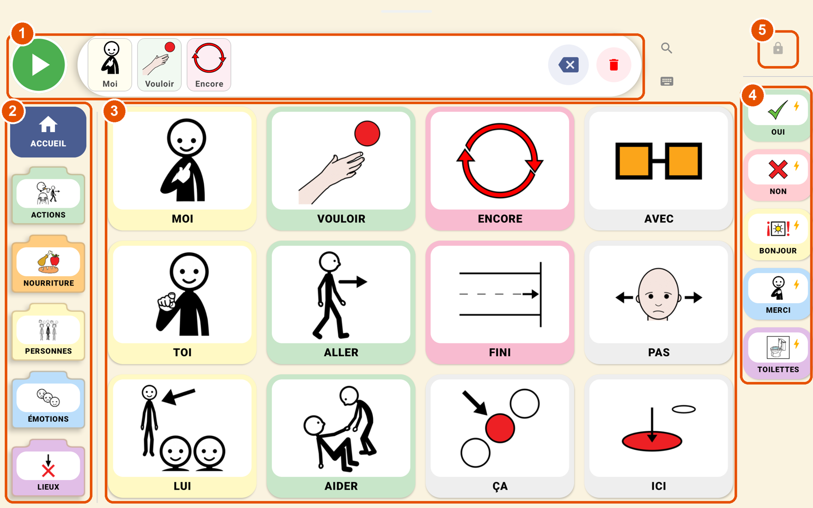

# Nina 1.1 — Notes de version

Ce document présente les différences entre **Nina 1.0** et **Nina 1.1**.

La version 1.1 s'installe **par-dessus la version 1.0** : les grilles, dossiers, photos, statistiques et réglages déjà préparés sont conservés. Le guide « Nina - mise a jour 1.0 vers 1.1 » explique la marche à suivre.

---

## L'écran principal de Nina 1.1

1. **Barre de phrase** : les mots choisis, avec leur image ; le bouton vert lit la phrase.
2. **Colonne des dossiers**, avec Accueil toujours en haut.
3. **Grille des mots essentiels**, toujours à la même place.
4. **Phrases rapides**, dites immédiatement.
5. **Cadenas** du mode adulte (à maintenir 2 secondes).

---

## En bref

> **Une nouvelle organisation de l'écran** : dossiers à gauche, mots essentiels toujours à la même place au centre, phrases rapides à droite. Plus aucun défilement.
>
> **Un mode adulte repensé** : cadenas discret à maintenir 2 secondes, et tous les outils réunis dans une barre en haut de l'écran.
>
> **De nouvelles fonctions** : photos personnelles, planche imprimable, grilles prêtes, formes des verbes, modélisation, statistiques datées, sauvegardes automatiques, commande oculaire (expérimentale).

---

## 1. L'écran de l'enfant

### Organisation « Core First »
- **Colonne de gauche** : les **dossiers** (Actions, Nourriture, Personnes, Émotions, Lieux…), avec **Accueil** toujours en haut. Toucher un dossier l'ouvre depuis n'importe où, et le dossier ouvert est encadré.
- **Grille centrale** : à l'accueil, les **mots essentiels** (moi, vouloir, encore, pas, aider…), toujours à la même place. L'enfant automatise ses gestes plus facilement.
- **Colonne de droite** : les **phrases rapides** (oui, non, bonjour, merci, toilettes…).

### Grille sans défilement
- De **1 à 8 pictos par rangée**, au choix ; ce réglage est maintenant **mémorisé**.
- S'il y a trop de pictos, des boutons **Page précédente / Page suivante** apparaissent en bas de la grille, et ▲ ▼ dans les colonnes. Ils sont lus à voix haute.
- Les cases vides de la dernière page gardent leur place : les pictos ne bougent pas.

### Barre de phrase
- Chaque mot de la phrase est affiché avec **son image et le texte en dessous**.
- Toucher la barre lit la phrase ; le bouton **effacer** retire le dernier mot, la **poubelle** efface tout.
- Une alerte rouge **« Son coupé »** apparaît si le volume de la tablette est à zéro. La toucher ouvre le réglage du volume.

### Navigation
- **Retour automatique à l'accueil** après le choix d'un mot dans un dossier (désactivable dans les Paramètres).
- Les boutons **Accueil**, **Retour** (sous-dossiers) et de page sont **lus à voix haute**.
- **Plein écran** : plus de barre d'état ni de barre de navigation Android qui cachent le bas de l'application.
- L'écran **ne se met plus en veille** tant que Nina est ouverte.

---

## 2. La langue

- **Formes du mot par appui long** : un appui long sur un verbe propose ses formes conjuguées (mange, manges, mangeons, mangé…), et sur un nom ou un adjectif, ses formes au pluriel ou au féminin.
- **Moteur de conjugaison et d'accord** amélioré pour la lecture de la phrase.
- **Texte prononcé personnalisé** : un picto peut dire une phrase différente de son texte. Par exemple, le picto « Toilettes » peut dire « J'ai besoin d'aller aux toilettes ».

---

## 3. Le mode adulte

- **Cadenas discret** : petit et gris, pour ne pas attirer l'enfant. Il faut le **maintenir 2 secondes**, puis résoudre un calcul.
- **Barre d'outils en haut de l'écran** : Ajouter, Édition, Paramètres, Statistiques, Aide, nombre de pictos par rangée, et un menu **⋮** pour le reste. Elle ne réduit pas la taille de la grille.
- **Ajouter** permet de choisir la zone : grille (ou dossier ouvert), colonne des dossiers, ou phrases rapides.
- **Glisser-déposer** (appui long puis glisser) :
  - dans la grille, **dans les dossiers**, et dans les deux colonnes ;
  - échange, ou insertion avant ou après, avec un trait bleu qui montre la place ;
  - d'une zone à une autre : le picto y est copié ;
  - pour changer de page, garder le picto une seconde sur un bouton de page.
- **Recherche d'un mot et modélisation** (loupe) : Nina montre à l'enfant le chemin vers un mot, case après case, avec un cadre orange qui clignote.

---

## 4. Images et photos

- **Plusieurs banques de pictogrammes** dans la recherche : ARASAAC, Mulberry, Sclera, Blissymbolics, et d'autres via OpenSymbols.
- **Photos personnelles** : bouton **Prendre une photo** (appareil photo de la tablette) ou **Galerie**. La photo est réduite, redressée et enregistrée dans la tablette.
- **Toutes les images sont enregistrées dans la tablette** : Nina reste entièrement utilisable **sans internet**.

---

## 5. Grilles prêtes et planche imprimable

- **Grilles prêtes** : trois niveaux de vocabulaire à installer en un geste, avec un retour possible à la disposition précédente.
- **Planche imprimable** (menu ⋮) : un **PDF** des grilles, avec les pictos aux mêmes places qu'à l'écran. Une page d'accueil, puis une page par dossier. À imprimer ou à partager, pour communiquer sans la tablette.

---

## 6. Suivi et sauvegardes

- **Statistiques datées** : mots et phrases utilisés par jour, semaine ou mois, **exportables en CSV** pour l'orthophoniste.
- **Sauvegarde partagée complète** : grille, dossiers, phrases rapides et **photos** dans un seul fichier.
- **Sauvegardes automatiques** : une par jour, conservées 7 jours. Si les données sont abîmées, Nina **récupère automatiquement** la dernière grille valable.
- **Vérification de la voix** : un avertissement apparaît si la voix française a besoin d'internet, avec la marche à suivre pour l'installer hors ligne.

---

## 7. Commande oculaire (expérimentale)

Nina peut être pilotée **par le regard**, avec la caméra frontale de la tablette. Tout le traitement se fait dans la tablette : aucune image n'est enregistrée ni envoyée.

- **Calibration sur les pictos**, précédée d'une courte étape « tourne doucement la tête ».
- **Sélection par fixation** : un anneau se remplit sur la case regardée (durée réglable), avec un **aimant** vers la case la plus proche.
- **Calibration continue** : chaque picto choisi améliore la calibration au fil de l'utilisation.
- **Grille adaptée au regard** (moins de pictos, plus d'espace) et **sélection en deux temps** (zoom), en option.
- **Interrupteur général** : désactivée, la caméra est éteinte ; réglages et calibration sont conservés.

> La précision dépend beaucoup de l'éclairage et de la position de la tablette : en moyenne 1 à 2 cm. Elle ne remplace pas une commande oculaire infrarouge du commerce.

---

## 8. Corrections et améliorations

- Le **glisser-déposer** fonctionne maintenant **à l'intérieur des dossiers** et des colonnes.
- Les **statistiques** comptent correctement les mots (les dossiers ne sont plus comptés).
- Modifier puis déplacer un picto ne perd plus les modifications.
- Les images ARASAAC introuvables sont remplacées automatiquement.
- Chaque picto a un **identifiant unique** : deux pictos identiques ne se confondent plus.
- **Application plus fluide** (version finale optimisée) : les ralentissements les plus longs sont environ 3 fois plus courts.
- **Aide & Tutoriel entièrement refaite** : plein écran, 15 rubriques, nouveautés signalées, et une section **À propos** (numéro de version).

---

Nina 1.1 — © 2026 Skygame
